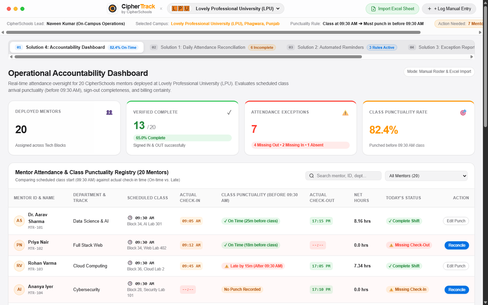
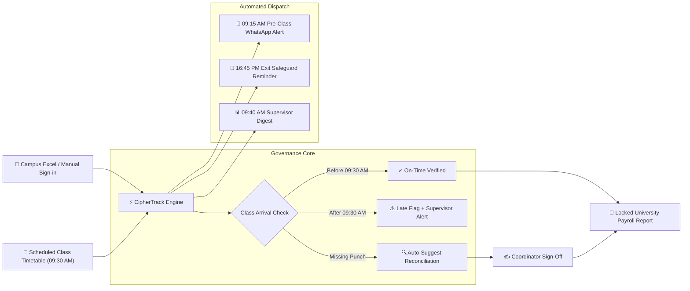
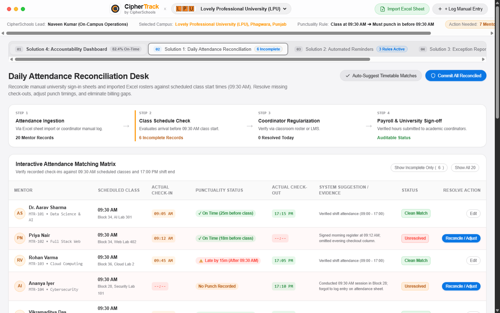
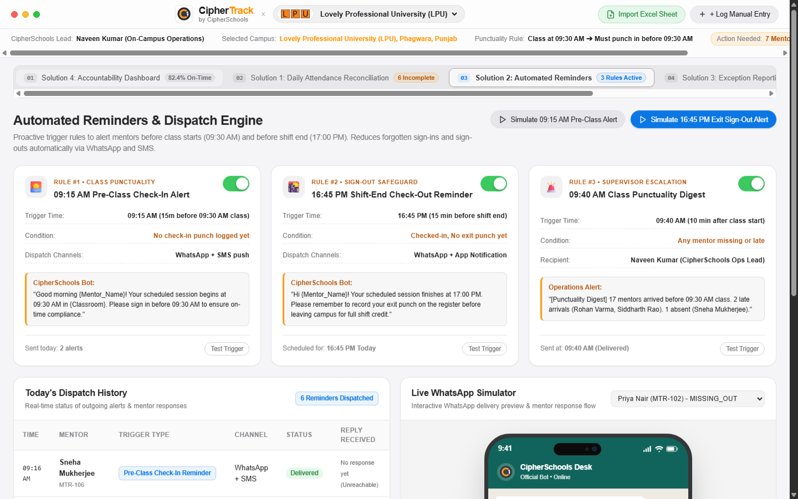
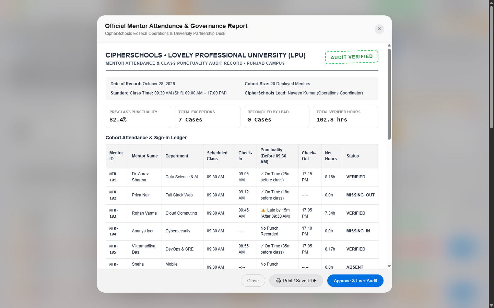

<p align="center">
  
</p>

<h1 align="center">CipherTrack</h1>

<p align="center">
  <strong>EdTech Mentor Attendance Governance & Reconciliation Desk</strong><br>
  Built for CipherSchools Operational Coordinators overseeing 20 mentors deployed at university partner campuses.
</p>

<p align="center">
  
  
  
  
  
  
</p>

---

<p align="center">
  
</p>

---

## 📌 Executive Overview

CipherSchools deploys **20 technical mentors** to partner university campuses (Lovely Professional University, Chandigarh University, Chitkara, and Thapar). Because academic buildings and lecture halls lack biometric hardware:

* **Manual Rosters & CSV Exports**: Attendance is tracked via sign-in sheets and daily university Excel uploads.
* **09:30 AM Class Cutoff**: Mentors must be present in assigned classrooms and logged in **before 09:30 AM**.
* **Incomplete Evening Punches**: Lab sessions frequently lead to forgotten **17:00 PM** check-outs.
* **Billing & Audit Risk**: Missing punches introduce stipend calculation friction and partner compliance gaps.

**CipherTrack** provides a unified desk to reconcile rosters against academic timetables, automate WhatsApp arrival/exit alerts, resolve discrepancies in one click, and lock auditable university reports.

---

## 🏛️ Partner Campus Deployments

CipherTrack dynamically switches campus configurations, shift rules, and reporting formats across our partner institutions:

<div align="center">

| Lovely Professional University | Chandigarh University | Chitkara University | Thapar Institute |
| :---: | :---: | :---: | :---: |
|  |  |  |  |
| **LPU Phagwara** | **CU Mohali** | **Chitkara Rajpura** | **TIET Patiala** |

</div>

---

## 📐 System Architecture & Workflow



---

## 🚀 The 4 Integrated Solutions

### 1. Daily Attendance Reconciliation Desk
* **Timetable Comparison Matrix**: Pairs recorded punches against class start times (09:30 AM) and shift exits (17:00 PM).
* **Auto-Suggest Timetable Pairing**: Algorithmic engine infers missing records from student LMS rosters and timetable data.
* **One-Click Regularization**: Resolve missing punches instantly with an immutable audit log.

<p align="center">
  
</p>

---

### 2. Automated Reminders & Alerts Dispatcher
* **Rule #1 (09:15 AM Pre-Class Entry)**: Warns mentors without punches 15 minutes before 09:30 AM classes.
* **Rule #2 (16:45 PM Shift-End Safeguard)**: Proactively reminds lab mentors 15 minutes before 17:00 PM to record sign-out.
* **Rule #3 (09:40 AM Supervisor Escalation)**: Delivers an automated morning digest of late/unreported mentors to the lead.
* **Interactive WhatsApp Simulator**: Test message templates and two-way mentor responses in real time.

<p align="center">
  
</p>

---

### 3. Accountability Telemetry & Cohort Registry
* **Live KPI Deck**: Deployed Mentors (20), Verified Complete, Active Exceptions, and Class Punctuality Rate.
* **Search & Roster Filters**: Filter instantly by On-Time, Late Arrival, Missing Out, Missing In, or Absent.
* **Fast Manual Punch Logging**: Record walk-in punches with coordinator notes and room assignments.

---

### 4. University Exception Reporting & Formal Audit
* **Discrepancy Registry**: Centralized clearinghouse for under-hours, unexcused tardiness, and punch gaps.
* **Official University Audit Document**: Clean, printable formal audit report with university header, verification stamp, and Dean/Coordinator signature blocks.
* **CSV Export**: One-click download of standardized attendance data for payroll integration.

<p align="center">
  
</p>

---

## ⚡ Quick Start

No build tools, bundlers, or package installations required. Runs natively in any modern browser.

### 1. Clone the repository
```bash
git clone https://github.com/cipherschools/attendanceTrackingPlatform.git
cd attendanceTrackingPlatform
```

### 2. Start a local server
```bash
# Using Python (recommended)
python -m http.server 3000

# OR using Node.js
npx serve .
```

### 3. Open in browser
Navigate to **`http://localhost:3000`** in your browser.

> [!TIP]
> Use the **"Import Excel Sheet"** button to load sample university attendance data or upload your own `.xlsx` / `.csv` file. You can reset to the baseline cohort anytime via the reset trigger.

---

## 🛠️ Technology Stack

| Layer | Technology | Key Capabilities |
| :--- | :--- | :--- |
| **Design Language** | Apple Human Interface Guidelines (HIG) | macOS Sequoia frosted glass, iOS switches, Dynamic Island, squircle cards |
| **Typography** | SF Pro & SF Mono (Apple System Fonts) | Legible telemetry data, tabular numerals (`tabular-nums`), punch ledgers |
| **Frontend Core** | Semantic HTML5 & Modern CSS3 | Custom Apple design system, responsive layout, zero external CSS bloat |
| **Logic & State** | Vanilla ECMAScript (ES6+) | Instant DOM reactivity, zero external build overhead |
| **Data Persistence** | Browser `localStorage` | Seamless state persistence between tab reloads & sessions |
| **Import / Export** | Client-side CSV & Matrix Parser | Instant Excel/CSV parsing and structured payroll CSV export |

---

<p align="center">
  <sub>CipherTrack is maintained by the CipherSchools EdTech Operations & University Delivery Team.</sub>
</p>
